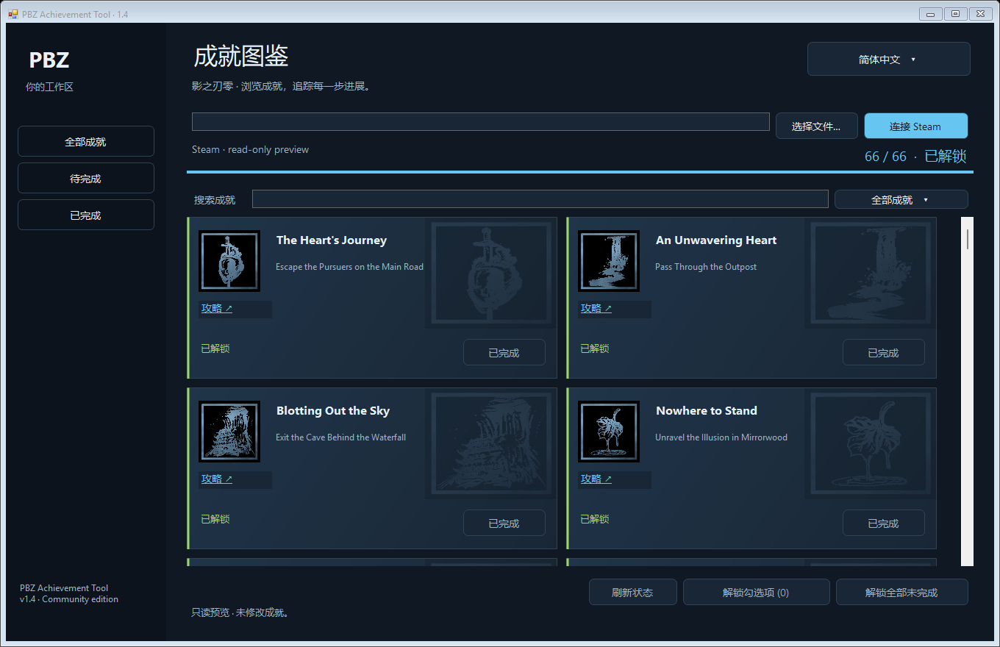

# PBZ Achievement Tool

[简体中文](docs/README.zh-CN.md) · [繁體中文](docs/README.zh-TW.md)

A small Windows desktop utility for **Phantom Blade Zero** Steam achievements (App ID `4115450`). English, Simplified Chinese and Traditional Chinese interfaces are included in one executable.



## Features

- Dark cards with actual Steam achievement icons, names and descriptions; responsive one/two-column layout.
- Search by name, description or ID; filter locked/unlocked entries. Checked selections persist across filters.
- Each card opens short guide reminders, missable markers and an attributed link to [Nero's Steam guide](https://steamcommunity.com/sharedfiles/filedetails/?id=3829337248). Full routes remain on the source page. The guide is a work in progress, updated November 1, 2026; its claims may become outdated.
- Read all 66 achievements and show the connected Steam account.
- Unlock checked achievements or unlock all remaining achievements with one click.
- Wait for Steam's successful `UserStatsStored_t` callback, then read back each submitted achievement.
- No save editing, password collection, telemetry, or bundled game binaries.

## Run

1. Download the Windows x64 executable from Releases, or build it below.
2. Start Steam and sign into an account with access to the game.
3. Run `PBZAchievementTool.exe` normally, without administrator privileges.
4. Select **Browse**, then choose `steam_api64.dll` from your Phantom Blade Zero installation. For example: `PBZ/steam_api64.dll` or `PBZ/platform/steam/steam_api64.dll`. Only select a library from your trusted game installation: this loads native code.
5. Click **Connect Steam**, check the displayed account, then use a card's **Unlock** button, **Unlock selected** or **Unlock all remaining**. Unlock all applies to every remaining achievement, regardless of search/filter.

The game itself does not need to be running. Unlock buttons change the connected account immediately; the tool does not provide achievement reset. Already unlocked entries are skipped. If Steam does not confirm the save, the application reports an error rather than claiming success. After a timeout, reconnect before retrying.

The interface language selector translates the application controls. Achievement names come from Steam and follow Steam's game language, which may differ from the interface language.

## Build

Version 1.1 reads icons via SteamUtils v011. Icons load from Steam at runtime; no individual game icon assets are bundled. Missing icons display an ID placeholder and retry while connected. Achievement text follows Steam's language; application controls and guide reminders support all three interface languages.

Version 1.1 validation: build passed; read-only integration returned 66 states and 66 icons. Three-language UI checks passed for filtering, search, empty states, selection persistence, narrow layouts and preventing writes in preview mode. Guide layout was visually inspected. No achievements were modified during these tests. Bulk writes remain untested on an incomplete account.

Requires Windows x64 and .NET Framework 4.5 or newer (4.8 recommended). No NuGet packages are required.

```powershell
powershell -ExecutionPolicy Bypass -File .\build.ps1
```

Output: `dist/PBZAchievementTool.exe`. An optional GitHub Actions template is included at `docs/build-workflow.yml`; copy it to `.github/workflows/build.yml` to enable automated builds.

## Verification and limitations

The original single-achievement repair was verified with Steam's successful storage callback and readback. This desktop application's read-only integration check does not modify achievements. Bulk unlocking cannot be meaningfully retested on an already completed account without resetting achievements, which this project deliberately does not do.

Developer checks:

```powershell
# Read-only integration check; writes a local result file. Does not unlock anything.
.\dist\PBZAchievementTool.exe --check "C:\path\to\PBZ\steam_api64.dll" "$PWD\check.txt"
# Render the disconnected UI without contacting Steam.
.\dist\PBZAchievementTool.exe --preview "$PWD\preview.png"
```

Only App ID `4115450`, achievement IDs `ACH_001`–`ACH_066`, SteamUserStats v013 and SteamUser v023 are supported. Future game or Steam API changes may require updates. A locally set flag without a successful storage callback is not treated as verified completion. On submission failure, some achievements may already have been accepted; reconnect and inspect before retrying. The DLL selection is session-scoped; restart the tool to switch game libraries after connecting.

## License

MIT for this project's source. Steam and Phantom Blade Zero belong to their respective owners. This is an independent community utility, not an official product. Game DLLs are supplied by the user's own installation and are not redistributed.


## v1.2 — Automatic connection

On normal startup, the tool reads the Steam registry location and libraryfolders.vdf, locates appmanifest_4115450.acf, and connects using the installed game's Steam DLL. No DLL selection is needed when discovery succeeds. Steam must already be running and signed in. If discovery or connection fails, manual Browse/Connect remains available. Startup only reads achievements; it never unlocks them. Diagnostic and preview modes do not auto-connect.

## v1.3 — Minimal light interface

A ChatGPT-inspired light workspace with left navigation, rounded buttons and neutral colors. The sidebar collapses on narrow windows. Steam auto-connect, achievement cards, guides and all three languages remain available. This is an independent PBZ community tool, not an OpenAI product.

## v1.4 — Steam-style collection, 15 languages, loading feedback

The new collection uses blue-black gradient cards, enlarged real achievement icons, subtle artwork watermarks, hover highlights and colored completion markers. Loading now has an animated progress strip and per-batch counts; data loading yields to the UI thread.

Language menus no longer dispose themselves during their own close/click event. Selection is queued until the menu event returns. Regression checks cover 15 locales, menu selection, animated frame advancement, filters, selection persistence and narrow layouts; a read-only connected Steam test switched language and filter menus 30 times each without crashing. The original user crash was not captured in the Windows event log, so this fixes the identified menu lifecycle hazard rather than claiming a verified stack trace match.

Supported UI locales match the [Steam store language list](https://store.steampowered.com/app/4115450/), checked November 12, 2026: English, Simplified Chinese, Traditional Chinese, French, German, Spanish (Spain), Spanish (Latin America), Russian, Japanese, Portuguese (Brazil), Portuguese (Portugal), Korean, Italian, Thai and Vietnamese. Tool translations are community-authored, not official game translations; regional Spanish and Portuguese variants share the main interface wording. Achievement text remains in the Steam game language. The four specific guide reminders remain in English/Chinese; other locales show a translated prompt to consult the original guide.
