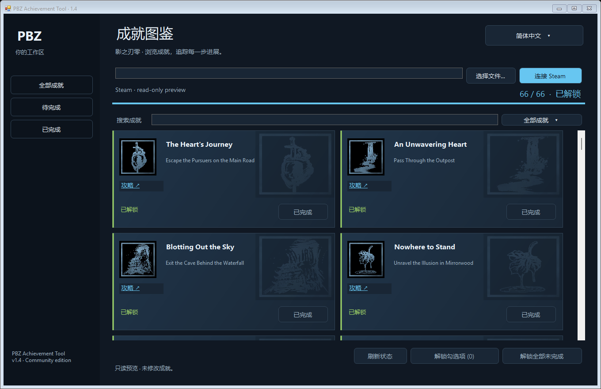
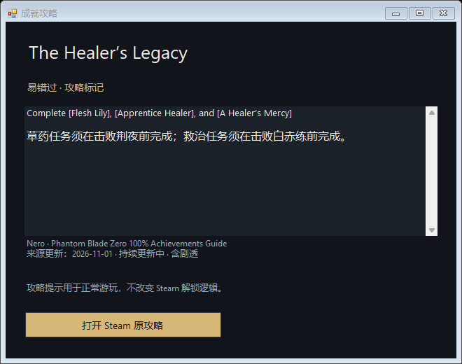

# 影之刃零 Steam 成就工具

[English](../README.md) · [繁體中文](README.zh-TW.md)

Windows 桌面工具，支持简体中文、繁体中文和英文。读取 66 项成就状态，支持勾选解锁和一键解锁全部未完成成就，无需修改存档或运行游戏。

## 使用

### v1.1 卡片界面

深色成就卡片展示 Steam 提供的真实游戏图标、名称、说明及完成状态。支持搜索、筛选、单卡解锁和勾选批量解锁；切换筛选保留勾选项。“解锁全部未完成”作用于所有未完成成就，不受筛选影响。



点击卡片“攻略”或成就标题，可查看易错过标记、关键提醒及 [Nero 原攻略](https://steamcommunity.com/sharedfiles/filedetails/?id=3829337248) 链接。完整路线保留在来源页面，未全文复制。原文更新于 2026-11-01，仍在编写中。



已验证三种语言、搜索筛选、勾选保留、窄窗口布局，以及 Steam 的 66 项状态和 66 个图标读取。测试没有修改成就。游戏成就文字跟随 Steam 语言，工具菜单和攻略提醒跟随界面语言。

1. 从 Releases 下载程序，启动并登录 Steam。
2. 运行 `PBZAchievementTool.exe`，通常无需管理员权限。
3. 选择自己游戏安装目录中的 `steam_api64.dll`，例如 `PBZ/steam_api64.dll`。程序会加载该本机库，请使用可信的游戏文件。
4. 点击“连接 Steam”，核对界面中的账号。
5. 勾选成就后点击“解锁勾选项”，或点击“一键全部解锁”。按钮会直接修改当前 Steam 账号。

程序等待 Steam 确认保存，并重新读取成就验证结果。已解锁项会跳过。若超时或出错，请重新连接检查状态；部分项目可能已经提交成功。工具不提供重置功能。语言菜单翻译界面控件，成就名称使用 Steam 返回的游戏语言。连接后需要换 DLL 时，请重启程序。

## 构建

需要 Windows x64 和 .NET Framework 4.5 以上，推荐 4.8。在项目目录运行：

```powershell
powershell -ExecutionPolicy Bypass -File .\build.ps1
```

程序生成于 `dist/PBZAchievementTool.exe`，无需 NuGet 依赖。附带 GitHub Actions 构建模板 `docs/build-workflow.yml`，可自行启用。

## 验证范围

单项 API 修复已经取得 Steam 保存成功回调并回读确认。桌面工具通过只读集成检查，不会为测试而重置已有成就；批量解锁仍需在有未完成项目的账号上验证。

仅支持 App ID `4115450` 和当前 66 项成就。不会上传存档、收集密码或发送遥测。项目不分发游戏 DLL。源代码采用 MIT 许可，本项目为非官方社区工具。


## v1.2 自动连接

启动时自动识别 Steam 游戏库和影之刃零安装目录，并连接 Steam。需要 Steam 已启动并登录。自动识别失败时仍可手动选择文件并连接。自动连接只读取成就，不会自动解锁。
