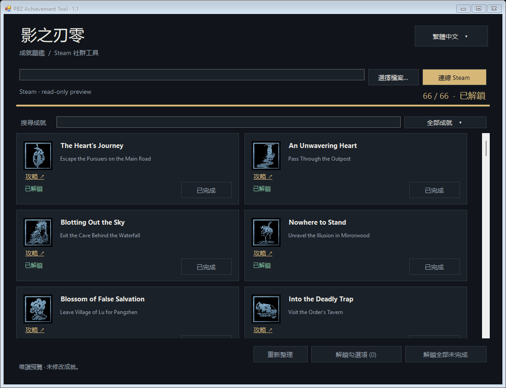

# 影之刃零 Steam 成就工具

[English](../README.md) · [简体中文](README.zh-CN.md)

Windows 桌面工具，內建繁體中文、簡體中文與英文介面。讀取 66 項成就，支援勾選解鎖及一鍵解鎖全部未完成成就，無需修改存檔或執行遊戲。

## 使用

### v1.1 卡片介面

深色卡片顯示 Steam 提供的遊戲圖示、名稱、說明與完成狀態。支援搜尋、篩選、單項與批次解鎖；切換篩選時保留勾選項。「解鎖全部未完成」不受目前篩選影響。



卡片的「攻略」及標題可開啟易錯過標記、簡短提醒與 [Nero 原攻略](https://steamcommunity.com/sharedfiles/filedetails/?id=3829337248)。完整路線留在來源頁面，未全文複製。原文更新於 2026-11-01，仍在編寫中。

已通過三語介面、搜尋篩選、勾選保留、窄視窗及 Steam 的 66 項狀態與圖示讀取檢查，測試未修改成就。成就文字跟隨 Steam 語言，介面及攻略提醒跟隨工具語言。

1. 從 Releases 下載程式，啟動並登入 Steam。
2. 執行 `PBZAchievementTool.exe`，通常不需要系統管理員權限。
3. 選擇遊戲安裝目錄中的 `steam_api64.dll`，例如 `PBZ/steam_api64.dll`。程式將載入原生程式庫，請使用可信的遊戲檔案。
4. 點擊「連線 Steam」，核對顯示的帳號。
5. 勾選成就並點擊「解鎖勾選項」，或使用「一鍵全部解鎖」。按鈕將直接修改目前 Steam 帳號。

程式等待 Steam 確認儲存，再重新讀取成就驗證。已解鎖項目會略過。逾時或失敗時，請重新連線檢查狀態，部分項目可能已成功提交。工具不提供重置功能。介面語言與 Steam 回傳的成就名稱語言可能不同。連線後如需更換 DLL，請重新啟動工具。

## 建置

需要 Windows x64 與 .NET Framework 4.5 以上，建議 4.8：

```powershell
powershell -ExecutionPolicy Bypass -File .\build.ps1
```

輸出為 `dist/PBZAchievementTool.exe`，無 NuGet 相依套件。附有 GitHub Actions 建置範本 `docs/build-workflow.yml`，可自行啟用。

## 驗證範圍

單項 API 修復已收到 Steam 儲存成功回呼並回讀確認。桌面工具執行唯讀整合檢查，不會為測試重置現有成就；批次解鎖仍需在有未完成成就的帳號上驗證。

僅支援 App ID `4115450` 與目前 66 項成就。不會上傳存檔、收集密碼或傳送遙測，也不散布遊戲 DLL。原始碼採用 MIT 授權。本工具為非官方社群專案。


## v1.2 自動連線

啟動時自動識別 Steam 遊戲庫及遊戲安裝位置並連線。請先啟動並登入 Steam。找不到安裝位置時仍可手動選擇檔案。自動連線只讀取成就，不會自動解鎖。

## v1.4 更新

Steam 風格深色漸層卡片、大圖示、懸停高亮及完成標記。加入載入動畫與分批進度，修正語言選單的生命週期風險。

介面支援商店列出的 15 種語言，工具譯文為社群翻譯，成就文字仍跟隨 Steam 遊戲語言。地區西語及葡語共用主要介面譯文，四項具體攻略提醒保留中英文，其他語言引導至原攻略。

15 語介面與動畫檢查通過；連線 Steam 後語言及篩選各切換 30 次未崩潰。未修改成就。
